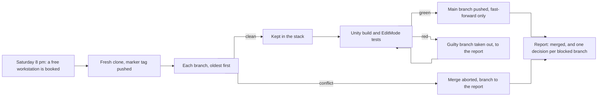
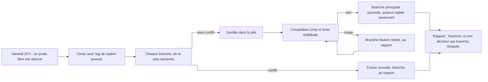

# Agent - Weekly merge

Every Saturday evening, it merges into a Unity project's main branch every branch that goes in without conflict and passes the tests.




**English** · [Français](#version-française)

*What sews together goes in; the rest becomes a question.*

## What it does

- **Plants a marker before any merge**: a tag `fusion/avant-<date>` is set and pushed on the main branch, so going back is a single command.
- **Tries each branch, sets conflicts aside.** One branch at a time, oldest to newest, merged without fast-forward. A conflict aborts the merge of that branch, which goes to the report with the files touched, the authors and what each one changes.
- **Builds and tests, takes out the guilty branch.** Unity in batch mode, EditMode tests, on the merged state. If it is red, the agent removes the branches one by one until it finds the guilty one, takes it out of the stack and starts again until green. PlayMode tests, some of which depend on the network, are not run, and the report says so.
- **Pushes without forcing, one decision per blocked branch.** Fast-forward push only, never `--force`. If the main branch moved in the meantime, the agent builds and tests again on the new base.

It is meant for a team where several people and several agents each work in their own branch of the same project. Merging a little every week costs less than merging everything once a month: the agent does the mechanical part (try, build, test, roll back) and only keeps for humans what needs a choice.

## The report

```
Fusionné
  feature/menu-pause      → a1b2c3d
  fix/collisions-sol      → e4f5a6b
  Repère : fusion/avant-2026-11-14 · Tests EditMode : 142 / 142 · PlayMode non lancés

Décisions à prendre
  feature/nouvel-inventaire : conflit avec master sur InventoryUI.cs (deux mises en page différentes).
    A — garder celle de la branche   B — garder celle de master   C — la reporter d'une semaine
    D — autre chose
```
*(fictional example; the report is written in French)*

## What it never does

- Delete a branch, rewrite history, force-push.
- Send anything to a device, publish a release, touch the app store.
- Make noise: the workstation stays silent and Unity runs muted.
- Ask a question: it works alone and puts in the report everything it could not settle.

## Requirements

Taken from `lancer.sh` and `consigne.md`:

- A server with `bash`, GNU `date`, `cron`, `python3`, `ssh` and `scp`, that runs `lancer.sh`.
- A project whose main branch is called `master` (the instructions push `master`).
- A workstation manager, a Python script, that lends and takes back workstations (`demander` / `rendre`), and a launcher that starts a Claude Code agent on a workstation (`<ssh host> <name> <instructions>`).
- The workstation: a Windows machine reachable by SSH, with Unity, git and a key that can push to the project repository.
- [Claude Code](https://code.claude.com/docs/en/overview) on the workstation.

## Install

```bash
git clone https://github.com/anthohunt/agent-fusion-hebdomadaire
cd agent-fusion-hebdomadaire
cat > reglages.local <<'EOF'
PROJET="mon-jeu"; NOM="fusion"
RAPPORTS=$HOME/fusion/rapports
GESTIONNAIRE=$HOME/outils/postes.py        # demander <poste> --nom --besoin  /  rendre <poste> --nom
SIGNAUX=$HOME/fusion/signaux.jsonl
POSTES="poste-a poste-b"
LANCEUR_POSTE=$HOME/outils/agent-poste      # <hôte ssh> <nom> <consigne>
DEPOT="git@example.org:equipe/mon-jeu.git"
UNITY="6000.3.12f1"
EOF
./lancer.sh essai
# crontab with the server on Paris time: Saturday 8 pm, catch-up Sunday 9 am
# 0 20 * * 6 /path/lancer.sh
# 0 9 * * 0  RATTRAPAGE=1 /path/lancer.sh
```

`lancer.sh essai` shows the settings and the day's instructions without booking a workstation or starting anything. The Sunday catch-up run does nothing if Saturday's report exists.

## Files

| File | Role |
|---|---|
| `lancer.sh` | Books a workstation, starts the agent, follows it (600 checks one minute apart, about 10 hours), brings back the report, wipes the working copy once the report is back (otherwise it stays on the workstation), hands the workstation back, signals the result to the manager. |
| `consigne.md` | The instructions given to the agent, with fields (`{{DEPOT}}`, `{{UNITY}}`, `{{DATE}}`…) filled in at launch. |
| `reglages.local` | The settings of the installation (repository address, Unity version, workstations, local tools), outside the repository. |

The instructions and comments are in French. It is one of the permanent agents that run on their own every day or every week in a small system of Claude Code agents.

## Its page

- English: <https://ingevision.cloud/en/ai-agents/?p=agent-fusion-hebdomadaire>
- Français : <https://ingevision.cloud/agents-ia/?p=agent-fusion-hebdomadaire>

---

## Version française

# Agent - Fusion hebdomadaire

Chaque samedi soir, il fusionne dans la branche principale d'un projet Unity toutes les branches qui passent sans conflit et réussissent les tests.




*Ce qui se recoud seul entre ; le reste devient une question.*

### Ce qu'il fait

- **Plante un repère avant toute fusion** : un tag `fusion/avant-<date>` est posé et poussé sur la branche principale ; revenir en arrière tient en une commande.
- **Essaie chaque branche, met de côté les conflits.** Une branche à la fois, de la plus ancienne à la plus récente, fusionnée sans avance rapide. Un conflit annule la fusion de cette branche, qui part au rapport avec les fichiers touchés, les auteurs et ce que chacun change.
- **Compile et teste, retire la branche fautive.** Unity en mode batch, tests EditMode, sur l'état fusionné. Si c'est rouge, l'agent retire les branches une par une jusqu'à trouver la fautive, la sort de la pile et recommence jusqu'au vert. Les tests PlayMode, dont certains dépendent du réseau, ne sont pas lancés, et le rapport le dit.
- **Pousse sans forcer, rend une décision par branche bloquée.** Poussée en avance rapide seulement, jamais de `--force`. Si la branche principale a bougé entre-temps, l'agent reprend la compilation et les tests sur la nouvelle base.

Il sert à une équipe où plusieurs personnes et plusieurs agents travaillent chacun dans sa branche d'un même projet. Fusionner un peu chaque semaine coûte moins cher que tout fusionner une fois par mois : l'agent fait la part mécanique (essayer, compiler, tester, revenir en arrière) et ne garde pour les humains que ce qui demande un choix.

### Le rapport

```
Fusionné
  feature/menu-pause      → a1b2c3d
  fix/collisions-sol      → e4f5a6b
  Repère : fusion/avant-2026-11-14 · Tests EditMode : 142 / 142 · PlayMode non lancés

Décisions à prendre
  feature/nouvel-inventaire : conflit avec master sur InventoryUI.cs (deux mises en page différentes).
    A — garder celle de la branche   B — garder celle de master   C — la reporter d'une semaine
    D — autre chose
```
*(exemple fictif)*

### Ce qu'il ne fait jamais

- Supprimer une branche, réécrire l'historique, pousser en force.
- Envoyer quoi que ce soit vers un appareil, publier une version, toucher au magasin d'applications.
- Faire du bruit : le poste reste muet et Unity tourne sans son.
- Poser une question : il travaille seul et met dans le rapport tout ce qu'il n'a pas pu trancher.

### Ce qu'il faut

Tiré de `lancer.sh` et `consigne.md` :

- Un serveur avec `bash`, `date` de GNU, `cron`, `python3`, `ssh` et `scp`, qui lance `lancer.sh`.
- Un projet dont la branche principale s'appelle `master` (la consigne pousse `master`).
- Un gestionnaire de postes, un script Python, qui prête et reprend les postes (`demander` / `rendre`), et un lanceur qui démarre un agent Claude Code sur un poste (`<hôte ssh> <nom> <consigne>`).
- Le poste : une machine Windows joignable en SSH, avec Unity, git et une clé qui peut pousser sur le dépôt du projet.
- [Claude Code](https://code.claude.com/docs/en/overview) sur le poste.

### Installation

```bash
git clone https://github.com/anthohunt/agent-fusion-hebdomadaire
cd agent-fusion-hebdomadaire
cat > reglages.local <<'EOF'
PROJET="mon-jeu"; NOM="fusion"
RAPPORTS=$HOME/fusion/rapports
GESTIONNAIRE=$HOME/outils/postes.py        # demander <poste> --nom --besoin  /  rendre <poste> --nom
SIGNAUX=$HOME/fusion/signaux.jsonl
POSTES="poste-a poste-b"
LANCEUR_POSTE=$HOME/outils/agent-poste      # <hôte ssh> <nom> <consigne>
DEPOT="git@example.org:equipe/mon-jeu.git"
UNITY="6000.3.12f1"
EOF
./lancer.sh essai
# crontab, serveur à l'heure de Paris : samedi 20 h, rattrapage dimanche 9 h
# 0 20 * * 6 /chemin/lancer.sh
# 0 9 * * 0  RATTRAPAGE=1 /chemin/lancer.sh
```

`lancer.sh essai` montre les réglages et la consigne du jour sans réserver de poste ni rien lancer. Le rattrapage du dimanche ne fait rien si le rapport de la veille existe.

### Fichiers

| Fichier | Rôle |
|---|---|
| `lancer.sh` | Réserve un poste, lance l'agent, le suit (600 contrôles à une minute d'écart, environ 10 h), rapatrie le rapport, efface la copie une fois le rapport rapatrié (sinon elle reste sur le poste), rend le poste, signale le résultat au manager. |
| `consigne.md` | La consigne donnée à l'agent, avec des cases (`{{DEPOT}}`, `{{UNITY}}`, `{{DATE}}`…) remplies au lancement. |
| `reglages.local` | Les réglages de l'installation (adresse du dépôt, version d'Unity, postes, outils locaux), hors dépôt. |

Fait partie des agents permanents qui tournent seuls chaque jour ou chaque semaine dans un petit système d'agents Claude Code.

### Sa fiche

- Français : <https://ingevision.cloud/agents-ia/?p=agent-fusion-hebdomadaire>
- English: <https://ingevision.cloud/en/ai-agents/?p=agent-fusion-hebdomadaire>

---

**Anthony Hunt** · [Agent page on ingevision.cloud](https://ingevision.cloud/en/ai-agents/?p=agent-fusion-hebdomadaire) · [LinkedIn](https://www.linkedin.com/in/anthony-hunt-3948a9196) · [GitHub profile](https://github.com/anthohunt) · anthony@ingevision.cloud
