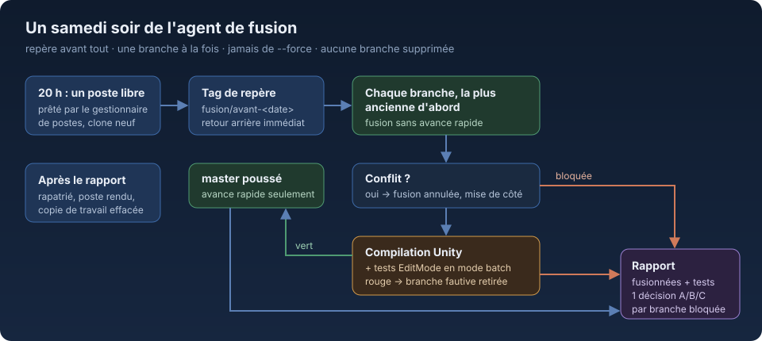

# Agent - Fusion hebdomadaire

**Chaque samedi soir, un agent Claude Code prend un poste de travail libre, fusionne dans la branche principale d'un
projet Unity toutes les branches qui passent sans conflit et réussissent les tests, puis rend un rapport de quelques
lignes : ce qui est entré, et une décision à prendre par branche bloquée, avec ses choix.**



## Pourquoi
Sur un projet où plusieurs personnes et plusieurs agents travaillent chacun dans leur branche, les fusions se
repoussent : chacun attend que l'autre ait fini, les branches divergent, et le jour où il faut tout rassembler, les
conflits se sont empilés. Fusionner un peu chaque semaine coûte moins cher que tout fusionner une fois par mois.
L'agent fait la part mécanique du travail (essayer, compiler, tester, revenir en arrière) et ne garde pour les humains
que ce qui demande un choix : deux branches qui changent le même fichier différemment, ou une branche qui casse les tests.

## Le déroulé
1. **Un poste libre.** À 20 h le samedi, le lanceur demande un poste au gestionnaire de postes, dans un ordre de
   préférence. Aucun libre : il le signale et réessaie le dimanche matin.
2. **Un clone neuf.** L'agent travaille dans son propre dossier, jamais dans une copie déjà présente sur le poste.
3. **Un repère d'abord.** Un tag `fusion/avant-<date>` est posé et poussé sur la branche principale avant toute
   fusion : revenir en arrière tient en une commande.
4. **Une branche à la fois**, de la plus ancienne à la plus récente, fusionnée sans avance rapide. Un conflit annule
   la fusion de cette branche, qui part au rapport avec les fichiers touchés, les auteurs et ce que chacun change.
5. **Compilation et tests** sur l'état fusionné : Unity en mode batch, tests EditMode. Les tests PlayMode, dont
   certains dépendent du réseau, ne sont pas lancés et le rapport le dit. Si c'est rouge, l'agent retire les branches
   une par une jusqu'à trouver la fautive, la sort de la pile et recommence jusqu'au vert.
6. **Poussée en avance rapide seulement**, jamais de `--force`. Si la branche principale a bougé pendant ce temps,
   l'agent reprend la compilation et les tests sur la nouvelle base.
7. **Le poste est rendu propre** : le rapport est rapatrié, la copie de travail effacée, la tâche planifiée retirée.

## Le rapport
```
Fusionné
  feature/menu-pause      → a1b2c3d
  fix/collisions-sol      → e4f5a6b
  Repère : fusion/avant-2026-11-14 · Tests EditMode : 142 / 142 · PlayMode non lancés

Décisions à prendre
  feature/nouvel-inventaire : conflit avec master sur InventoryUI.cs (deux mises en page différentes).
    A — garder celle de la branche   B — garder celle de master   C — la reporter d'une semaine
    D — autre chose
```
*(exemple fictif)*

## Ce qu'il ne fait jamais
- Supprimer une branche, réécrire l'historique, pousser en force.
- Envoyer quoi que ce soit vers un appareil, publier une version, toucher au magasin d'applications.
- Faire du bruit : le poste reste muet et Unity tourne sans son.
- Poser une question : il travaille seul et met dans le rapport tout ce qu'il n'a pas pu trancher.

## Fichiers
| Fichier | Rôle |
|---|---|
| `lancer.sh` | Réserve un poste, lance l'agent, le suit (10 h au plus), rapatrie le rapport, efface la copie, rend le poste, signale le résultat au manager. `lancer.sh essai` montre les réglages et la consigne du jour sans rien lancer. |
| `consigne.md` | La consigne donnée à l'agent, avec des cases (`{{DEPOT}}`, `{{UNITY}}`, `{{DATE}}`…) remplies au lancement. |
| `reglages.local` | Les réglages de l'installation (adresse du dépôt, version d'Unity, postes, outils locaux), hors dépôt. |

## Installation
```bash
git clone https://github.com/anthohunt/agent-fusion-hebdomadaire
cd agent-fusion-hebdomadaire
cat > reglages.local <<'EOF'
PROJET="mon-jeu"; NOM="fusion"
RAPPORTS=$HOME/fusion/rapports
GESTIONNAIRE=$HOME/outils/postes.py        # demander <poste> --nom --besoin  /  rendre <poste> --nom
SIGNAUX=$HOME/fusion/signaux.jsonl
POSTES="poste-a poste-b"
LANCEUR_POSTE=$HOME/outils/agent-poste      # <hôte ssh> <nom> <consigne>
DEPOT="git@example.org:equipe/mon-jeu.git"
UNITY="6000.3.12f1"
EOF
./lancer.sh essai
# crontab (heure du serveur)
# 0 19 * * 6 /chemin/lancer.sh
# 0 8 * * 0  RATTRAPAGE=1 /chemin/lancer.sh
```
Le poste doit être une machine Windows joignable en SSH, avec Unity, git et une clé qui peut pousser sur le dépôt.

Fait partie des agents permanents qui tournent seuls chaque jour ou chaque semaine dans un petit système d'agents
Claude Code.
